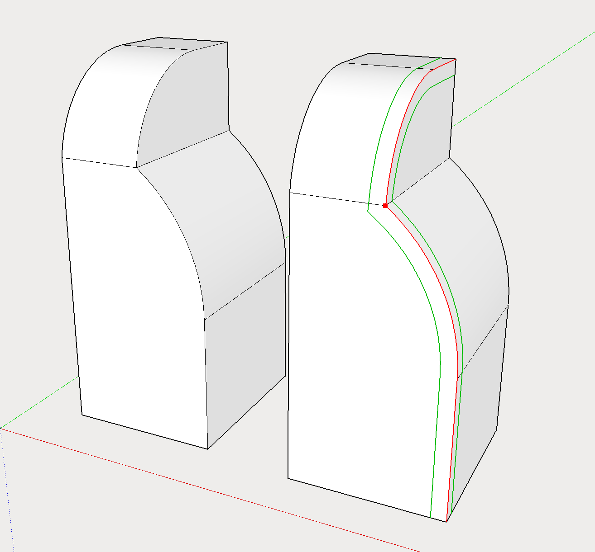
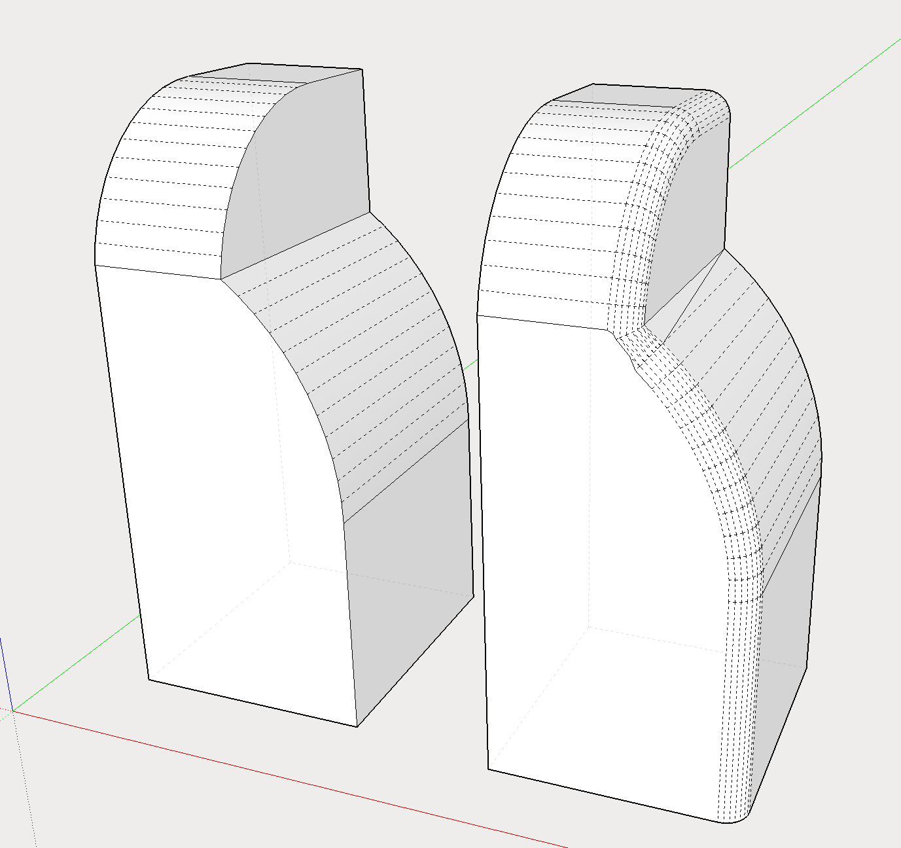

# Brief 56: Fillet / Chamfer anywhere

Status: **plan, for the owner** (2026-11-26). Owner: "make a plan for the fillet / chamfer tool to get it to work on situations like the session 29 body. You can generate an end-cap face if the fillcham needs to cut into another face. Fillcham should work on the session 29 body, that's why it's a good test." And: "I haven't even tried a more complicated 3D path, but I know those are possible too."

**Goal:** any edge with a face on each side rounds (fillet or chamfer), on real models drawn the SketchUp way, with lines drawn on faces, small leftovers from earlier edits, openings, and chains of edges that turn in 3D. A refusal is left only where there is no corner at all (a line on a flat face) or where nothing can be built. A size past what fits is handled as "as far as it goes" (DECISIONS #45).

## Why the session 29 body fails

The recording is `crates/prism-tools/tests/data/owner-session-29-open-fillet.json`; at event 118 the hovered edge is refused.

The body (42 faces) is closed, but the kernel does not take it as a solid, for two reasons. Both are in one face: the flat end face at x = 1.386, face 329.

1. **A notch.** A line and an arc 0.24 mm long run between the same two points, and nothing fills the space between them. Some earlier edit left it.
2. **A slit.** A line about 0.37 m long, in three pieces, is drawn into the face from its edge without dividing it. The face walks it out and back, so those edges have the same face on both sides.

The kernel needs every edge to have exactly two different faces. So the whole body counts as "not a closed solid". Every edge then falls back to Prism's own round, which only takes one straight edge between flat faces whose ends are plain three-edge corners. Most of the body's edges are not like that: they meet other rounded edges, sit beside cylinders, or end at busier corners.

What the existing round already does:
- lines drawn on faces in the round's way are taken off and drawn back (session 22);
- split points along a line are joined;
- edges in pieces are rounded as one;
- openings that lie in one plane are capped for the kernel (session 29, general case);
- rounds are made in turn where the kernel cannot do them all at once;
- the tip of an apex is cut off first.

None of that reaches face 329, because the slit and the notch make the whole body refused before any of it runs.

## The plan

### 1. A copy of the body the kernel can take

A round works on a copy of the body, prepared for the kernel. Prism's own model is changed only by the round itself: every repair below is undone or kept the way the user drew it, except where the step says otherwise.

| What | On the copy | Afterwards |
|---|---|---|
| Lines drawn on a face in the round's way | taken off (done) | drawn back where they still lie on a face (done) |
| A **slit**: edges one face walks out and back | taken off | drawn back, as far as they still lie on the face |
| A **notch or sliver**: two short edges between the same two points, under 100 × the precision | the two points welded | kept welded: the shape moves no more than the notch is long. Model Health also lists them, so Heal can fix them anywhere |
| An **opening that lies in one plane** | a flat cap (done) | cap taken away (done) |
| An **opening that does not lie in one plane** | a cap from the Loft ring fill (the same surface Loft's fill makes) | cap taken away |
| Faces turned the wrong way | turned on the copy | the round's new faces face the way their neighbours do |
| Other geometry in the same group that does not touch the body | left out of the copy | untouched |

Test: on the session 29 body, every edge between two faces that are not of one plane rounds at 0.093 m (the size in the owner's screenshot), as a fillet and as a chamfer. Edges whose faces are too narrow say so as "as far as it goes", not as a refusal. Face 329's slit is still there afterwards. Model Health is no worse.

### 2. End caps where a round cuts into another face (Prism's own round)

Prism's own round (`round.rs`) is the fallback when the kernel will not take even the prepared copy. Today it needs plain three-edge corners at both ends and an end face square to the edge. Owner: "you can generate an end-cap face if the fillcham needs to cut into another face". So each end of the round is closed as follows:

- **Plain corner, square end face:** as today: the end face gets the round's profile (a line or an arc).
- **Slanted end face:** the profile is cut by that face's plane. An ellipse for a fillet; a line for a chamfer. Today a slanted end is refused for fillets.
- **End at a busier corner, or where the round's setback runs into a neighbouring face:** an **end-cap face**. This is a flat face in the plane square to the edge, at the point where the round's setback lines leave the faces beside it. It is bounded by the profile and by the lines where that plane meets the neighbouring faces. The neighbouring faces are cut back to the cap, the way sticky geometry splits faces.

The end cap is always a flat face, so the result is a valid solid, and the user can push/pull or erase the cap like any face.

Tests:
- a box with a line drawn into the end face (a slit at the end);
- a wedge with a slanted end;
- an edge ending at a four-edge corner;
- a round whose setback crosses a short neighbouring face;
- each as fillet and chamfer, checked by volume (worked out by hand), Model Health clean.

### 3. Rounding locally when the whole body cannot go to the kernel

If the prepared copy is still not a solid (for example, an edge with three faces somewhere else on the body), round **just the neighbourhood**:

1. Take the faces beside the edges, and the faces at their ends.
2. Close them into a small solid with end-cap faces (step 2's caps, on the copy).
3. Round there through the kernel.
4. Put the round's new faces and the trimmed neighbours back into the model.

A problem elsewhere on the body then no longer blocks a round here.

Test: the session 29 body with one more fault added far from the edge (a third face on some edge). The edge still rounds.

### 4. Chains of edges that turn in 3D (the owner's "more complicated 3D path")

- **Tangent chains** (a line running into an arc, a Follow Me path): already rounded as one by the kernel on solids. On open bodies and fallback rounds they are taken as one chain too: the whole run is collected with one click (as straight runs are now), and the round follows it.
- **Chains with corners** (a 3D polyline path, the edges of a twisted extrusion): each corner is closed by the corner rules (DECISIONS #46): in turn, or the corner cut off first. With Prism's own round, two rounds meeting at a corner are mitred: both are cut by the plane that halves the angle between them, and the cut is filled.
- **Edges on freeform (NURBS) faces:** the kernel rounds only between flat, cylindrical and conical faces. For freeform faces, the round is fitted within the document's precision (DECISIONS #40, as Deform does): a rolling-ball surface sampled along the edge and fitted as a NURBS face.

Tests:
- a Follow Me tube along a 3D path with corners, all its outer edges filleted;
- a swept profile along a 3D curve;
- a lofted shape's edge between a NURBS face and a flat one.

### 4a. The owner's SketchUp example (2026-11-26)

 

**The body:** a block whose top runs over two curved faces, with a smaller block on top.

**The chain:** one round follows a chain of edges (red in the first picture):
- down the front of the top block;
- through a kink (the red point), where the faces on one side change from the top block's curved face to the lower body's;
- along the curved front;
- down to the base, where it ends in a rounded corner.

What it shows Prism should do:

- **The preview** draws the two setback lines (green) on the faces beside the chain, along its whole length, before the round is made. This is the highlight the fillet redo asked for. On curved faces, those lines are curves on the face.
- **A chain on curved faces through a kink:** the round runs on across the kink. Where the faces on one side change there, the two rounds meet and are joined, as at a corner (step 4's mitre, or a corner patch).
- **An end cap where the round cuts into a step:** SketchUp needed the owner to patch the front face by hand (the small triangle at the step under the top block). That patch is step 2's end cap, which Prism makes itself.
- **The round ends in a rounded corner at the base** (three rounds meeting): the corner rules.

**What Curviloft does, and where Prism must do better** (owner, 2026-11-26):

- **Good: it reconciles connected edges.** Where the selected edges meet, Curviloft extends the setback lines (the green ones) so the round along one edge does not come up short of the next. Prism does the same: where two edges of a chain meet, each round's setback lines run on to meet the next round's, so the rounds join with no gap and no step.
- **Bad: it overshoots, and leaves a face out.** At the top curve the round ran past where it should stop. The curve where it met the front face was not in that face's plane, so Curviloft dropped the front face altogether, and the owner rebuilt it by hand. Prism must:
  - trim each round exactly where it meets a face, so the line it leaves on a flat face lies in that face;
  - never leave a face out: a face the round cuts into is cut back, or closed with an end cap (step 2);
  - check this with Model Health after every round: no hole, no face missing, no line off its face.
- **Chains go anywhere:**
  - through inside walls (concave edges, a round that fills in rather than cuts away);
  - across bends and kinks;
  - along curves, arcs and freeform edges;
  - mixing all of these in one chain.

  Where something is beyond the precision it can be made to (Curviloft has such limits too), the round is built as far as it goes and the rest is marked orange (DECISIONS #45), never left as a hole.

**Test:** this body, built in code, rounded along the whole chain in one go, as fillet and chamfer:
- the chain is collected with one click;
- Model Health is clean;
- no face has to be patched by hand (the front face is there, flat, cut back to the round);
- the setback lines in the preview lie on the faces.

### 5. The smooth corner patch (DECISIONS #46)

Replaces the small flat facet at an apex: an n-sided patch that meets each round's slope at its edge.

Tests: a pyramid tip; a cube corner with three different sizes (once rounds can have per-edge sizes).

### 6. The tool

- **Hover:** shows what the round would make, including end caps, and in orange what it could not do.
- **Message:** the cursor label and Fillet window say which step was taken where it matters. For example: "the end is closed by a flat cap", or "a notch 0.24 mm long was welded".
- **Session 29 replay:** the owner's recording goes into the tests once step 1 is in: the hovered edge's run rounds at 0.093 m.

## Research: how other tools do it (2026-11-26)

### Where rounds meet at a corner

**Three corner types, as Fusion and Inventor offer them:**
- **Rolling ball:** the ball runs on round the corner. Three equal outside rounds meet in a piece of a sphere, which is exact. This is what the kernel already does for a box corner.
- **Setback:** each round stops a set distance back from the corner (the setback, a length per edge, as SolidWorks offers). The hole left is filled with an n-sided patch that meets each round smoothly.
- **Mitre:** the rounds are cut where they meet by the plane that halves the angle. Exact on planes, cylinders and cones, which is why Inventor makes it the default.

**The setback patch, as Várady and Rockwood build it:**
- an n-sided corner becomes a 2n-sided patch (one side per round's end, one per setback line);
- it is built from ordinary four-sided patches meeting at a "setback split";
- its control frame is made by chamfering again and again.

Other ways to fill an n-sided hole smoothly: Gregory patches, Coons–Gregory and transfinite patches. Commercial kernels (Parasolid, ACIS, Open CASCADE) are said to use setback corners with n-sided patches that meet their neighbours smoothly (G1).

**Mixed corners** (inside and outside rounds at one point) are the hard case everywhere:
- ViaCAD's vertex blend only works where all the rounds turn the same way.
- Open kernels refuse mixed corners, or get kinks in them.
- Vendors advise rounding in this order:
  - inside (concave) rounds before outside ones;
  - larger before smaller;
  - all the edges at a corner in one go where possible, else in a set order.

  Prism's "round in turn" (built today) follows this already.

### Where a round runs past its faces (overflow)

**SolidWorks offers two ways to finish a round that runs into another face:**
- **Keep edge:** the neighbouring face's edge stays where it is. The round is broken up to fit it, and can dip.
- **Keep surface:** the round stays smooth and whole. The neighbour's edge is moved to meet it.

Parasolid names more cases: a smooth extension; a "cliff", where the round touches only one face and runs along an edge of the other; a cliff end; and a notch. For a round that runs off a cliff, kernels have moved from "build it as if the faces went on, then cut the extra away" to "trim it at the creases where it is built".

**For Prism:** the owner's end cap is the cliff-end case done the "trim where built" way. The cap closes the round's end against the face it runs into, and that face is cut back to it. Keep edge and keep surface are the two choices at such an end. The owner's Curviloft example shows what goes wrong with neither: the round overshot, and its edge left the plane of the face.

### Chains

- **Fusion collects tangent chains**: edges that run on into each other without a corner. Its tangency tolerance is fixed, and a near-tangent kink stops the chain.
- **Prism's chain rules:**
  - judge tangency by the document's precision, as everything else is (DECISIONS #42);
  - run on across corners when the user asks (a click on the chain, or a modifier);
  - close the corners in the chain with the corner types above.
- **Reconciling where edges meet** (what Curviloft does by extending the setback lines) is the setback idea at a chain's joints: each joint's setback lines run on until they meet the next round's, and the joint is closed by a mitre or a small patch, not left short.

### Rounds along curved and freeform faces

- **A rolling-ball round is the trace of a ball touching both faces.** Its centre runs along the curve where the two faces, each moved out by the radius, cross (the spine; Choi and Ju, 1989). The round is the arc between the ball's two contact curves, swept along it.
- **How the spine is found:** marched step by step along the crossing of the two offset surfaces. Later work marches without making the offsets at all.
- **How the round is stored:** the exact sweep is not a NURBS surface, so CAD systems fit it with NURBS (least squares). For Prism that means fitted within the document's precision, as DECISIONS #40 allows for deforms. This is how rounds beside freeform (lofted) faces can be built where the kernel only takes flat, cylindrical and conical faces.
- **Variable radius** (a round that changes size along the edge) uses the same marching with the radius changing. It is a later step, not part of this brief.

### What this changes in the plan

1. **Step 2 (end caps):** offer keep edge (the end cap, the neighbour's edge untouched) and keep surface (the neighbour's edge moved to meet the round). Keep edge is the default, as it is what the owner asked for.
2. **Step 4 (3D chains):** joints between rounds are closed by a mitre by default. A setback patch is offered where a mitre would leave a kink. Rounds beside freeform faces are built by marching the spine and fitting the round within the precision.
3. **Step 5 (corners):** three corner types: rolling ball (exact sphere for three equal outside rounds, the kernel's), setback (n-sided patch, Várady–Rockwood style, filled with a Gregory-type patch), and mitre. Mixed corners in turn, inside rounds first, larger first. A corner type in the Fillet window, defaulting to rolling ball where it works and setback where it does not.
4. **Ordering:** when rounding many edges in turn, take the inside rounds first and the larger first (the vendors' rule), before trying other orders.
5. **Preview:** the setback lines drawn on the faces (step 4a) are also where a setback corner's patch starts, so the preview shows the corner patch's outline too.

### Sources

- Várady and Rockwood, "Geometric construction for setback vertex blending", Computer-Aided Design, 1997: https://sciencedirect.com/science/article/pii/S001044859600070X and https://eprints.sztaki.hu/1451 ; "Vertex blending based on the setback split": https://eprints.sztaki.hu/909/ ; "Vertex blending: problems and solutions": https://cs.purdue.edu/cgvlab/www/publications/varady1998vertex
- Malraison, survey of n-sided surfaces (Gregory patches, setback blends): https://apps.dtic.mil/sti/pdfs/ADP012035.pdf
- Hwang and Chuang, N-sided hole filling and vertex blending: https://ir.lib.nycu.edu.tw/bitstream/11536/27575/1/000186572400008.pdf
- SolidWorks fillets (setback, keep edge / keep surface, overflow type): https://help.solidworks.com/2019/english/SolidWorks/sldworks/r_constant_size_fillets.htm , https://help.solidworks.com/2022/english/SolidWorks/sldworks/c_example_overflow_type.htm
- Fusion fillet reference (corner type, rolling ball, setback, tangent chain): https://help.autodesk.com/cloudhelp/ENU/Fusion-Model/files/SLD-REF-FILLET.htm , https://help.autodesk.com/cloudhelp/ENU/Fusion-Model/files/SLD-REF-TANGENT-CHAIN.htm
- Fusion fillet best practices (concave before convex, larger first): https://www.autodesk.com/products/fusion-360/blog/get-smart-with-fusion-360-fillet-best-practices/
- ViaCAD vertex blend (same convexity only): https://help.imsidesign.com/docs/viacad-v14-user-guide/solid-modeling/feature-based-solids/
- Fillet failures by kernel (Parasolid overflow modes, secondhand): https://cadshift.com/blog/fillet-kernel-comparison-solidworks-inventor-freecad/
- Choi and Ju, constant-radius blending (offset intersection, spine): https://koreascience.kr/article/JAKO199711920641317.pdf ; variable radius: https://ir.lib.nycu.edu.tw/handle/11536/2146 ; rolling-ball fillet patent with Gregory patches along a spine: https://patents.google.com/patent/US5345546
- Open kernels' issue trackers on setback and mixed corners and overflow (secondhand, for what others ran into): https://github.com/barocss/barocss/issues/2259 , https://github.com/tangency-labs/solidcore/issues/960

## Order of work

1. Step 1 (slits, notches, non-flat openings), with session 29 as the test. **This is what makes the owner's body work.**
2. Step 2 (end caps).
3. Step 3 (local round).
4. Step 4 (3D chains, freeform faces), with the owner's SketchUp example (4a) as its test.
5. Step 5 (corner patch).
6. Step 6 (tool messages) as each lands.

Each step:
- tests (unit tests, and session replays where there is one);
- the rule-order note in DECISIONS #44 updated: what the round does to a copy, and what it leaves changed;
- release notes;
- a release.

## Owner's answers (2026-11-26)

1. **The notch weld: kept in the model** (as proposed).
2. **End caps:** to decide after seeing both in Prism: screenshots of a flat cap square to the edge, and of a cap lying in the face the round runs into (keep edge / keep surface), on a block whose end is slanted. Not taken yet: the screenshot run was stopped before a compact. Plan: build both by hand in a render test (`crates/prism-render/tests/common` can draw off screen and `Image::save` writes a PNG), and send them.
3. **A drawn line across a round's path:** also to decide after screenshots: the line stopping at the round (as now), and the line running on across it as a curve on the round.

Screenshots sent 2026-11-27, made by `crates/prism-render/tests/fillet_options.rs` (run by hand with `--ignored`). What they showed:
- **End caps:** Prism's own round already takes a block whose end is slanted, and makes B (the round runs on into the slanted end; its end lies in that face). A (a flat cap square to the edge, the corner beyond left sharp) was built by hand for the picture.
- **Line across a round:** when a line drawn on one face reaches the edge, the kernel's round is parted at the line's end, so a seam already carries the line on across the round (B). The line stopping where the round begins (A) is what the fallback round does; it was built by hand for the picture.

Owner, 2026-11-27: **end caps: B is correct** (the round runs on into the face it meets, its end lying in that face). Tried on the owner's stepped block (a top edge and the slope's edge rounded together, the slope ending on a lower step): Prism's round already does it at 0.5 m and 0.3 m; the round's end is a curve in the step's top face, with no extra face, and the model checks clean (`a_stepped_block_rounded_down_its_slope`). So step 2's end cap becomes "keep surface" by default, and the flat cap is kept only for where the round's end cannot lie in the face it meets.

Owner, 2026-11-27: **a line across a round: B too** (the line carries on across the round as a seam, as the kernel's round does today). So the fallback round (`round_through_lines`) must match it: a line it takes off and draws back is also drawn across the round's own face, as a curve on it. The stepped-block result was approved as shown.

## Questions for the owner (as asked)

1. **The notch weld.** Keep it in the model (proposed: it is a defect, and moves the shape no more than 0.24 mm)? Or weld only on the copy, and leave the notch for Heal?
2. **End caps.** A flat cap square to the edge (proposed)? Or a cap in the plane of the face the round runs into, which looks like the round "dies into" that face, as some CAD programs do?
3. **A line drawn across a round's path.** It is drawn back on the faces it still lies on (as now). Should it also continue across the round's own face, as a curve on it?
